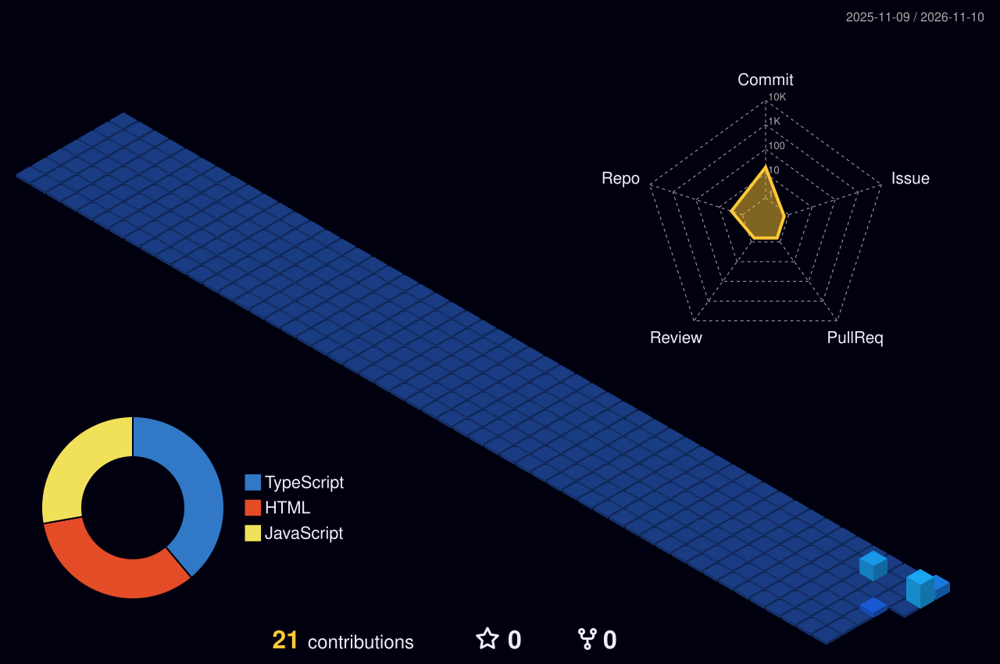

<a href="https://scroll-and-serif.vercel.app"><picture><source media="(prefers-color-scheme: dark)" srcset="assets/hero-dark.svg?v=1"></picture></a>

<picture><source media="(prefers-color-scheme: dark)" srcset="assets/about-dark.svg?v=1"></picture>

<picture><source media="(prefers-color-scheme: dark)" srcset="assets/stack-dark.svg?v=1"></picture>

<picture><source media="(prefers-color-scheme: dark)" srcset="assets/id-dark.svg?v=1"></picture>

## Selected work

<table>
<tr>
<td width="50%" valign="top"><a href="https://dar-architecture.vercel.app"><picture><source media="(prefers-color-scheme: dark)" srcset="assets/work-dar-dark.svg?v=1"></picture></a></td>
<td width="50%" valign="top"><a href="https://aurelle-perfume-ashen.vercel.app"><picture><source media="(prefers-color-scheme: dark)" srcset="assets/work-aurelle-dark.svg?v=1"></picture></a></td>
</tr>
<tr>
<td width="50%" valign="top"><a href="https://zaytoun-restaurant.vercel.app"><picture><source media="(prefers-color-scheme: dark)" srcset="assets/work-zaytoun-dark.svg?v=1"></picture></a></td>
<td width="50%" valign="top"><a href="https://caucasus-sweets-home.vercel.app"><picture><source media="(prefers-color-scheme: dark)" srcset="assets/work-caucasus-dark.svg?v=1"></picture></a></td>
</tr>
</table>

Each card opens the live site. All four are independent concept and personal projects. The portfolio also shows three more websites.

<picture><source media="(prefers-color-scheme: dark)" srcset="assets/connect-dark.svg?v=1"></picture>

<table>
<tr>
<td width="25%" align="center"><a href="https://scroll-and-serif.vercel.app"><picture><source media="(prefers-color-scheme: dark)" srcset="assets/link-portfolio-dark.svg?v=1"></picture></a></td>
<td width="25%" align="center"><a href="mailto:alitsai55@gmail.com"><picture><source media="(prefers-color-scheme: dark)" srcset="assets/link-email-dark.svg?v=1"></picture></a></td>
<td width="25%" align="center"><a href="https://www.linkedin.com/in/ali-tsai/"><picture><source media="(prefers-color-scheme: dark)" srcset="assets/link-linkedin-dark.svg?v=1"></picture></a></td>
<td width="25%" align="center"><a href="https://www.instagram.com/scrollandserif"><picture><source media="(prefers-color-scheme: dark)" srcset="assets/link-instagram-dark.svg?v=1"></picture></a></td>
</tr>
</table>
